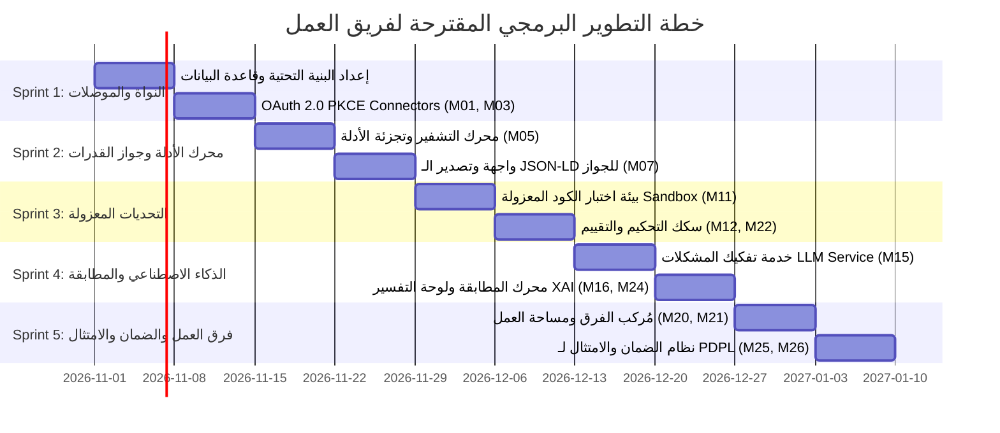

# دليل التسليم الشامل لفريق التطوير الهندسي — منصة قُدرة (QUDRA)
## Complete Engineering Handover & Delivery Package

مرحباً بفريق التطوير! هذا المجلد يمثل **حزمة التسليم الشاملة (Complete Delivery Package)** لمنصة **قُدرة (QUDRA)** — المنصة الذاتية الأولى القائمة على محرك أدلة الكفاءات الموثقة (Evidence Engine) وجواز القدرات الرقمي (Capability Passport) والمطابقة المُفسَّرة للمشكلات (Problem-to-Explainable Matching).

تم إعداد هذا المجلد ليكون مرجعاً تقنياً وتصميمياً متكاملاً لا يحتاج فيه أي مهندس (Frontend, Backend, AI/ML, DevOps) إلى تخمين أي سلوك أو تصميم أو مسار بيانات.

---

## 1. خريطة المجلد الشامل (Folder Structure)

```text
📁 قدرة/ (QUDRA Delivery Root)
│
├── 📄 HANDOVER_GUIDE.md                      # [هذا الملف] الدليل التنفيذي الشامل للتسليم وسير عمل الفريق
├── 📄 README.md                              # الدليل العام للمشروع ونظرة عامة على النظام والمعمارية
├── 📄 QUDRA_Competitor_Research_v2_...md      # المواصفة الأصلية المرجعية (1,040 شاشة و40 منصة منافسة)
│
├── 📁 docs/                                  # حزمة التوثيق الهندسي والتحليلي المتكامل
│   ├── 📄 competitor-research.md             # دراسة معمقة لـ 40 منصة (Upwork, Eightfold, Credly...) ومصفوفة التحسين
│   ├── 📄 screen-inventory.md                # جرد كامل للـ 1,040 شاشة (26 وحدة × 40 حالة + 156 شاشة ارتكاز)
│   ├── 📄 ux-architecture.md                 # المعمارية ثنائية الركائز، الأدوار الأربعة، ورحلات المستخدم
│   ├── 📄 design-system.md                   # رموز التصميم (Tokens)، التيبوغرافي العربي، المكونات والحالات
│   ├── 📄 implementation-status.md           # جدول تتبع تغطية الأولويات (P0 / P1 / P2) والمراحل
│   └── 📄 developer-handoff.md               # مخططات الـ JSON-LD، عقود الـ API، متطلبات الأمان والتشفير
│
└── 📁 qudra-app/                             # النموذج الأولي الإنتاجي التفاعلي (React 19 + Vite)
    ├── 📄 package.json                       # التبعيات وأوامر التشغيل والبناء
    ├── 📄 vite.config.js                     # إعدادات Vite مع دعم React
    ├── 📄 index.html                         # الصفحة الرئيسية مع استدعاء خطوط IBM Plex Sans Arabic المريحة
    │
    └── 📁 src/
        ├── 📁 styles/
        │   └── 📄 design-system.css          # نظام التصميم الكامل (CSS Tokens, مريح للعين، RTL/LTR)
        ├── 📁 components/
        │   ├── 📁 layout/                    # الهيدر، الشريط الجانبي، مستعرض الـ 1040 شاشة
        │   │   ├── 📄 Navbar.jsx             # شريط التنقل العلوي وتبديل الأدوار واللغة
        │   │   ├── 📄 Sidebar.jsx            # القائمة الجانبية المصنفة لـ 26 وحدة
        │   │   └── 📄 ScreenNavigator.jsx    # فاحص ومفتش الـ 1,040 شاشة التفاعلي
        │   ├── 📁 common/                    # المكونات المشتركة الدلالية
        │   │   ├── 📄 EvidenceBadge.jsx      # شارة الأدلة (Proven, Claimed, Gap)
        │   │   ├── 📄 TrustChip.jsx          # شريحة مستويات الثقة للموصلات (Official, User, Fragile)
        │   │   ├── 📄 ExplainDrawer.jsx      # لوحة تفسير قرارات الذكاء الاصطناعي (XAI Drawer)
        │   │   └── 📄 ToastContext.jsx       # نظام الإشعارات العائمة التفاعلية (Toast)
        │   └── 📁 modules/                   # شاشات الوحدات التفاعلية المكتملة
        │       ├── 📄 HomeDashboard.jsx      # M02: لوحة التحكم والقيادة الشاملة
        │       ├── 📄 ConnectorsHub.jsx      # M03: مركز موصلات الأدلة المعتمدة
        │       ├── 📄 EvidenceEngine.jsx     # M05: محرك تسجيل وفلترة الأدلة الرقمية
        │       ├── 📄 CapabilityPassport.jsx # M07: جواز القدرات الرقمي مع نسخة الـ AI JSON-LD
        │       ├── 📄 PracticeChallenge.jsx  # M11: بيئة التحديات البرمجية وفحص الكود المعزول
        │       ├── 📄 ProblemAnalyzer.jsx    # M15: تفكيك المشكلات التقنية وتوليد مصفوفة المهارات
        │       ├── 📄 TeamComposer.jsx       # M20: مُركِّب الفرق التكاملي لتغطية الفجوات
        │       ├── 📄 ProjectWorkspace.jsx   # M21: مساحة تسليم المراحل وتحويل المخرجات لأدلة
        │       ├── 📄 PrivacyConsent.jsx     # M25: إدارة الخصوصية وحقوق PDPL & GDPR
        │       └── 📄 GenericStateView.jsx   # القالب الموحد لجميع حالات الـ 40 شاشة و156 ارتكاز
        └── 📁 data/
            └── 📄 mockData.js                # قاموس الحالات والموديولات والبيانات التجريبية
```

---

## 2. ما الذي تم إنجازه وجاهز للتسليم الفوري؟

1. **النموذج التفاعلي المباشر (Working Codebase):**
   - كود React 19 حديث مبني بـ Vite 5.4.
   - يدعم العربية افتراضياً (RTL First) مع التحويل الفوري للإنجليزية (LTR).
   - نظام تصميم متكامل للرموز البصرية (Design Tokens) مبني لراحة العين دون أي تشتيت بصري.
   - مستعرض تفاعلي يستعرض مصفوفة الشاشات الـ **1,040** كاملة مع فلاتر شاشات الارتكاز (⚓).
   - لوحة تفسير شفافة لقرارات الذكاء الاصطناعي (Explainable AI Drawer).
   - خلو كامل من النوافذ المنبثقة البدائية (`window.alert`) واستبدالها بنظام إشعارات عائم سلس (`ToastProvider`).

2. **عقود ومخططات البيانات (Schemas & Contracts):**
   - معيار جواز القدرات بصيغة `JSON-LD` المفتوحة المتوافقة مع معايير W3C Verifiable Credentials.
   - مصفوفة مستويات الثقة الثلاثة للموصلات (`Official OAuth`, `User-Supplied`, `Fragile App Token`).
   - تصنيف الأدلة الثلاثي الصارم (`Proven`, `Claimed`, `Gap`).

---

## 3. خطة عمل فريق التطوير (Sprint Breakdown)

نقترح على الفريق الهندسي تنفيذ المنصة على **5 سبرنتات (Sprints)** مدة كل منها أسبوعان:



---

## 4. إرشادات التشغيل المحلي لفريق المطورين (Quick Start)

### المتطلبات
- Node.js (الإصدار 18 أو 20 أو أحدث).
- مدير الحزم npm أو pnpm.

### أوامر التشغيل
```bash
# 1. الدخول لمجلد التطبيق
cd qudra-app

# 2. تثبيت الحزم (أقل من دقيقة)
npm install

# 3. تشغيل خادم التطوير المحلي
npm run dev
# التطبيق سيعمل فوراً على: http://localhost:5173/

# 4. بناء نسخة الإنتاج النهائية واختبارها
npm run build
npm run preview
# نسخة الإنتاج المحسنة ستعمل على: http://localhost:4173/
```

---

## 5. معايير القبول والتسليم (Definition of Done)

قبل اعتماد أي ميزة أو شاشة في الإنتاج من قبل الفريق، يجب التحقق من الآتي:
- [x] **راحة العين وسهولة القراءة:** استخدام خط `IBM Plex Sans Arabic` مع `line-height: 1.75` ودون أي تباعد سلبي للحروف.
- [x] **دعم كامل لـ RTL و LTR:** كل عنصر ينقلب طبيعياً بناءً على اتجاه الصفحة دون كسر في الهوامش.
- [x] **تفسير شفاف:** أي درجة ترشيح أو مطابقة ذكاء اصطناعي يجب أن ترتبط بزر يفتح لوحة التفسير (XAI Drawer) ويوضح العوامل والخطوة البديلة (Counterfactual).
- [x] **أمان البيانات والخصوصية:** الامتثال التام لنظام حماية البيانات الشخصية السعودي (PDPL) بعدم استنتاج أو مشاركة أي بيانات دون موافقة صريحة من وحدة M25.
- [x] **حظر السكرابينغ الخفي:** لا يتم جلب أي بيانات خارجية إلا بموافقة صريحة عبر موصلات رسمية مصرحة (Zero Scraping Policy).
