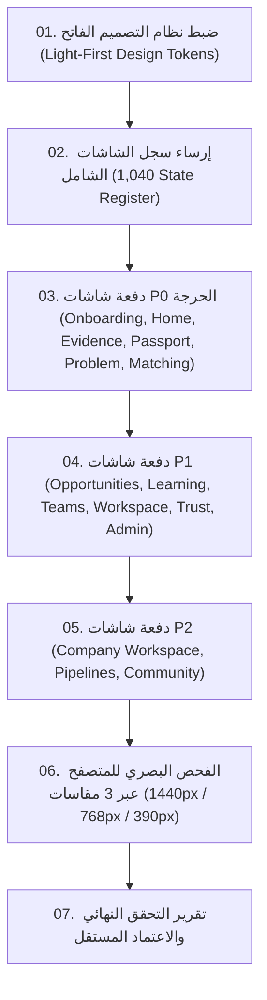

# 01 — فحص الحالة الراهنة وتدقيق الأساس (Baseline Audit)
## QUDRA UI/UX Design Studio — Root Cause & Baseline Evaluation

**تاريخ التدقيق:** 2026-10-21  
**المشروع:** قُدرة (QUDRA) — النسخة النهائية الحية  
**المسار:** `C:\Users\msi\Downloads\Compressed\Qudra-main_2\Qudra-main\qudra-final`  
**المرجع الأساسي:** `QUDRA_Competitor_Research_v2_and_1040_Screens.md`

---

### 1. ملخص تشخيص المشكلة (Executive Problem Statement)
أظهرت المراجعة النقدية للتحول السابق أن المشروع لا يزال يعاني من عدة مشاكل بنيوية وتصميمية تحول دون اعتباره منتجاً رقمياً ناضجاً ومنافساً:

1. **الانحياز المطلق للمظهر المظلم (Dark-Mode Skew):**
   - اعتمدت الجلسة السابقة على المظهر المظلم عالي التباين (Obsidian & Cyan) كافتراض أساسي، مما أعطى انطباعاً بأنه "لوحة تحكم تقنية داخلية للمطورين" (Technical Hacker Dashboard) بدلاً من **سوق رقمي مهني عربي رحب وموثوق** يخدم منشآت أعمال ومهندسين ومستقلين على غرار (LinkedIn, Mostaql, Upwork).
   - **القرار الحاسم:** تحويل **المظهر الفاتح (Light Interface)** ليكون هو الواجهة الافتراضية والأساسية الأولى في كل مكون وشاشة، مع ضبط درجات الرمادي والأسطح (`#F8FAFC`, `#FFFFFF`, `#F1F5F9`) ونصوص الجرافيت الداكنة (`#0F172A`) وحدود البطاقات الهادئة (`#E2E8F0`)، مع الإبقاء على المظهر المظلم كخيار ثانوي مدعوم بدقة لمن يفضله.

2. **تشابه القوالب وضعف التمايز الوظيفي (Template Uniformity):**
   - بدت عدة شاشات وكأنها نسخة مكررة من نفس القالب المكون من 3 بطاقات وبانر علوي وشريط مقاييس مكرر بنفس الحجم والوزن، بغض النظر عما إذا كانت الشاشة خاصة بـ "محرك الأدلة M05"، أو "جواز القدرات M07"، أو "سوق الفرص M17"، أو "مُركّب الفرق M20".
   - **القرار الحاسم:** تصميم كل شاشة Anchor بهيكلية تتناسب حصرياً مع هدف المستخدم وطبيعة بياناتها (Data Density & Task Alignment):
     - شاشات البورتفوليو والأدلة: بطاقات سردية غنية تبرز مستودعات الكود وروابط التحقق والقرائن.
     - شاشات السوق والمطابقة: تقسيم عمودي مرن (فلترة جانبية ذكية + بطاقات نتائج تبرز الفجوة المهارية والتكلفة وسبب الترشيح).
     - شاشات جواز القدرات: بطاقة هوية رقمية معتمدة قابلة للتصدير مع طبقة سياق الذكاء الاصطناعي (AI Context Layer).
     - شاشات الإدخال والتحليل: نماذج تفاعلية موجهة بالخطوات الحية مع حفظ المسودات المحلي.

3. **تسريب بقايا السقالات والرموز البرمجية الداخلية:**
   - احتوت نصوص واجهات عديدة على معرّفات الموديولات الداخلية مثل `M17 · Q-0641`، و `[Proj]` و `[FT]`، وأشرطة تنقل فرعية تعرض تبويبات التطوير الداخلي ("الحالة الفارغة"، "معالجة الخطأ").
   - **القرار الحاسم:** تنظيف كافة العناوين والنصوص لتكون لغة عربية مهنية سليمة، وإلغاء أي ظهور لأكواد الحزم الداخلية أمام المستخدم العادي.

4. **فخ مسار المنشأة (Problem Owner Trap):**
   - عند قيام صاحب المنشأة بطرح مشكلة برمجية لتحليلها، كان التدفق في النموذج الأولي القديم يوجه المستخدم إلى شاشة محاكاة كود مدتها 15 دقيقة ليحل الكود بنفسه!
   - **القرار الحاسم:** المنشأة تحتاج ترشيحاً فورياً للمهندسين المعتمدين بالأدلة وحساب فجوات المهارات، مع إتاحة خيار تكوين فريق هندسي متكامل فوراً.

---

### 2. تدقيق الأصول القائمة (Existing Code & Asset Inventory)

| العنصر | الحالة الراهنة | التقييم والقرار |
| :--- | :--- | :--- |
| **محرك التوجيه (`routes.tsx`)** | مكتمل ومفصل عبر 462 سطراً، ويغطي مسارات الوحدات 26. | **يُحتفظ به بالكامل** مع تحديث وتخصيص الصفحات المربوطة به. |
| **متجر البيانات (`store.ts`)** | يحتوي على بنية تخزين محلي `localStorage` لجميع الكيانات. | **يُحتفظ به** ويُغذى ببيانات واقعية تعكس حالات الأدلة والشهادات. |
| **سياق السمة (`ThemeContext.tsx`)** | كان يقرأ تفضيل المتصفح المظلم تلقائياً. | **تم تعديله** ليبدأ بالوضع الفاتح (`light`) افتراضياً. |
| **نظام الرموز (`tokens.css`)** | معرف جيداً لكنه كان مهمشاً لصالح النسخة المظلمة. | **إعادة ضبط وتفعيل كامل** لنظام التباين الفاتح (WCAG AAA). |
| **شاشة البداية (`SplashScreen.tsx`)** | كانت تتكرر في كل صفحة. | **تم حصرها بـ `sessionStorage`** لتظهر لمرة واحدة وبزمن 900ms. |
| **محرر الكود (`ChallengeSandboxPage`)** | شغال ويحتوي على بيئة بايثون متقدمة ومحرر أسطر. | **يُحتفظ به** كأحد أقوى عناصر إثبات الكفاءة الحية. |

---

### 3. خارطة الأولويات لتنفيذ الورشة التصميمية

تم توثيق الأساس، وجارٍ تأسيس وثيقة الأنماط التنافسية وسجل الشاشات.
