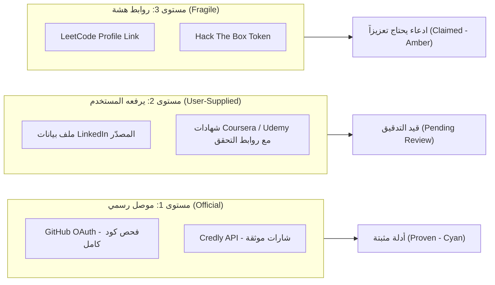

# 02 — الأنماط التنافسية المعتمدة والمُكيّفة لقُدرة (Competitive Patterns)
## QUDRA UI/UX Design Studio — Evidence-Based Competitive Pattern Matrix

**تاريخ التوثيق:** 2026-10-21  
**المرجع:** `QUDRA_Competitor_Research_v2_and_1040_Screens.md` (40 منافس / 212 ميزة / 217 عيب)  
**فريق البحث:** Agent 6 (Competitive Design Researcher) بالاشتراك مع Agent 1 (Lead Product Designer)

---

### 1. جدول الأنماط التنافسية الرئيسية وكيفية تكييفها

| المنافس والرمز | النمط المدروس | المشكلة التي يعالجها | سبب الملاءمة لقُدرة | التكييف الخاص بقُدرة (`Claim ≠ Evidence`) | ما تم استبعاده وتجنبه عمداً |
| :--- | :--- | :--- | :--- | :--- | :--- |
| **C01 · LinkedIn** | بطاقة الهوية المهنية الموثوقة، وتجميع مؤشرات الاعتماد في الترويسة. | السير الذاتية مليئة بادعاءات غير مفحوصة، ويصعب التأكد من حقيقة كفاءة الشخص. | مستخدمو الأعمال بحاجة لنظرة خاطفة فورية على اسم الشخص ومسماه وموثوقيته. | ربط نسبة الموثوقية (`Trust Score`) بأدلة كود حقيقية وشهادات مدققة لا بعدد العلاقات الاجتماعية أو التزكيات الصورية. | استبعاد خلاصات الأخبار الاجتماعية والمشاركات الشخصية غير الهندسية التي تشتت التركيز. |
| **C07 · Upwork** | فلاتر البحث متعددة المعايير (Faceted Search)، وتنسيق بطاقات الفرص بالراتب والموقع والموعد. | ضياع وقت المستقل وصاحب العمل في تصفح فرص غير مناسبة لمهاراتهم. | قُدرة منصة فرص ومشاريع برمجية تحتاج تصنيفاً فائق الوضوح (دوام كامل، مشروع مستقل، تحدي). | تزويد كل بطاقة فرصة بـ **«سبب المطابقة بالأدلة»** ونسبة مئوية واضحة وفجوات المهارات المطلوبة. | استبعاد حروب المضاربة بالأسعار ونظام المزايدات العشوائية التي تبخس قيمة المطور. |
| **C12 · Mostaql (مستقل)** | واجهة عربية أصيلة (RTL-First)، شبكة أعمدة مريحة للعين، ووضوح إجراءات تقديم العروض. | أغلب المنصات تعتمد ترجمة آلية معكوسة تهمل اتجاه حركة العين العربية ومحاذاة النماذج. | قُدرة منصة عربية أولاً تخاطب السوق السعودي والإقليمي كأولوية قصوى. | بناء كل المكونات باتجاه اليمين افتراضياً، مع عزل أرقام البرمجة والنسب الإنجليزية (`dir="ltr"`). | تجنب البوابات الثابتة المعقدة والرسوم المخفية؛ اعتماد الشفافية المالية المسبقة. |
| **C20 · CodersRank** | تحويل نشاط المطور البرمجي ومستودعاته إلى مؤشرات كفاءة رقمية معللة. | صعوبة قراءة الكود الخام لغير المتخصصين عند توظيف المطورين. | صميم فكرة قُدرة: فحص مستودعات GitHub واشتقاق الكفاءات المبرهنة تلقائياً. | دمج تقييم جودة الكود المعماري مع جواز القدرات الموحد (`Passport`) بدلاً من مجرد إحصاء الـ commits. | تجنب الاعتماد على مقاييس قابلة للتلاعب (مثل عدد الـ stars أو تكرار الـ commits السطحية). |
| **C24 · Eightfold** | شفافية الذكاء الاصطناعي وشرح أسباب الترشيح والمطابقة (Explainable AI / XAI). | قضايا تحيز خوارزميات التوظيف والخوف من قرارات الآلة المبهمة وغير المفسرة. | التزام قُدرة القانوني والأخلاقي: "كل استنتاج مرئي لصاحبه وقابل للاعتراض". | تضمين درج الشرح التفاعلي (`Explain Drawer`) لكل درجة مطابقة وترشيح. | تجنب بناء ملفات سرية أو تصنيفات خفية لا يراها المستخدم، وحظر أي استنتاج بلا موافقة معلنة. |
| **C22 · Credly & C21 Degreed** | شارات إثبات المهارات القابلة للتحقق المباشر من الجهة المانحة (Verifiable Badges). | الشهادات الورقية وملفات PDF يسهل تزويرها وتعديلها بالفوتوشوب. | قُدرة تعتمد مستويات ثقة صريحة للمصادر (`Official / User-supplied / Fragile`). | شريحة ثقة لكل دليل توضح تاريخه ومستواه ورابط التحقق الرقمي المباشر. | تجنب جمع شارات حضور عامة لا تثبت قدرة عملية حقيقية. |
| **Pinterest & Behance** | استعراض بصري ديناميكي منظم (Curated Showcase & Bento Grid) مع سردية القصة. | الملل البصري لقوائم الجداول الرمادية القديمة التي تشبه برامج إكسل. | استكشاف الكفاءات والمشاريع يجب أن يكون مشجعاً وجذاباً بصرياً لأصحاب الأعمال. | شبكة استكشاف الكفاءات في [`DiscoverPage.tsx`](file:///C:/Users/msi/Downloads/Compressed/Qudra-main_2\Qudra-main\qudra-final\src\pages\discover\DiscoverPage.tsx) تجمع الصورة والرمز والقرائن البرمجية باعتدال. | تجنب التمرير اللانهائي المشتت أو الحركات المبهرجة التي تبطئ التفاعل. |

---

### 2. مصفوفة مستويات ثقة الموصلات (Connector Trust Hierarchy)
تم اعتماد المصفوفة الواقعية للموصلات الموثقة في القسم الثاني من بحث المنافسين:

---

### 3. قرارات التصميم المشتقة للواجهات
1. **التباين اللوني في الواجهة الفاتحة:**
   - الدليل المبرهن (`Proven`): لون فيروزي وقور وأنيق (`#00B8B8` / نصوص `#007A7A` / خلفية شارة `#E6F8F8`).
   - الادعاء قيد الفحص (`Claimed`): لون ذهبي كهرماني واضح (`#FFC107` / نصوص `#B45309` / خلفية شارة `#FEF3C7`).
   - الفجوة المهارية (`Gap`): لون روز حيوي (`#EC4899` / نصوص `#BE185D` / خلفية شارة `#FDF2F8`).
2. **الاستقلالية البصرية لكل شاشة:**
   - شاشة عرض الفرصة تختلف جوهرياً عن شاشة عرض البروفايل، وتختلف عن شاشة تحليل المشكلة، وعن شاشة مساحة العمل ومختبر التحديات.
   - لكل شاشة وظيفتها الفريدة وميزانها البصري الخاص بها.
