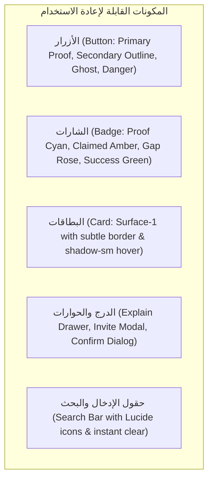

# 03 — نظام التصميم الموحد لقُدرة (QUDRA Design System)
## Light-First Commercial Digital Marketplace Design System

**الإصدار:** 2.1 (موجّه بالواجهة الفاتحة الافتراضية مع دعم كامل للوضع المظلم)  
**فريق التصميم:** Agent 3 (Senior Visual Designer) + Agent 4 (Typography) + Agent 5 (Design Systems Specialist) + Agent 8 (Accessibility & RTL)

---

### 1. اللوحة اللونية المعيارية (Light & Dark Color Roles)

#### أ. اللوحة الفاتحة الأساسية (Primary Light Palette — الافتراضية للجميع)
```css
:root {
  /* ألوان الخلفيات والأسطح */
  --ground:    #F8FAFC; /* خلفية الصفحة العامة (Slate 50) */
  --surface:   #FFFFFF; /* أسطح البطاقات والحاويات الرئيسية */
  --surface-2: #F1F5F9; /* الحقول والأسطح الفرعية المرتفعة (Slate 100) */
  --surface-3: #E2E8F0; /* أسطح التمرير والتبديل (Slate 200) */

  /* الحدود والفواصل */
  --line:      #E2E8F0; /* حدود البطاقات والأشرطة (Slate 200) */
  --line-soft: #F1F5F9; /* فواصل القوائم الناعمة */
  --line-hard: #CBD5E1; /* حدود الحقول النشطة */

  /* الطباعة والنصوص */
  --ink:       #0F172A; /* العناوين والنصوص الرئيسية (Slate 900) - كونتراست 15:1 */
  --ink-2:     #334155; /* النصوص التوضيحية الثانوية (Slate 700) - كونتراست 9:1 */
  --ink-3:     #64748B; /* التواريخ والبيانات المساعدة (Slate 500) - كونتراست 4.8:1 */

  /* ألوان الدلالة الجوهرية (QUDRA Core Semantics) */
  --proof:      #00B8B8; /* فيروزي الأدلة المثبتة (Turquoise) */
  --proof-text: #007A7A; /* نص الدليل المقروء على الخلفية الفاتحة */
  --proof-tint: #E6F8F8; /* خلفية شارة الدليل الناعمة */
  --proof-line: #B2EBF2; /* إطار شارة الدليل */

  --claimed:      #FFC107; /* ذهبي كهرماني للادعاء قيد الفحص */
  --claimed-text: #B45309; /* نص كهرماني داكن ذو تباين عالٍ */
  --claimed-tint: #FEF3C7; /* خلفية شارة الادعاء */
  --claimed-line: #FDE68A; /* إطار شارة الادعاء */

  --gap:      #EC4899; /* وردي حيوي للفجوات التقنية المطلوب ردمها */
  --gap-text: #BE185D; /* نص الفجوة الداكن */
  --gap-tint: #FDF2F8; /* خلفية شارة الفجوة */
  --gap-line: #FBCFE8; /* إطار شارة الفجوة */

  --danger:   #EF4444; /* خطأ / تحذير حرج */
  --success:  #10B981; /* اعتماد رسمي / اكتمال بنجاح */
}
```

#### ب. اللوحة المظلمة المدعومة (Refined Dark Companion Palette)
```css
:root[data-theme="dark"] {
  --ground:    #0B0F12; /* خلفية ليلية عميقة مريحة */
  --surface:   #141A1F; /* أسطح البطاقات الليلية */
  --surface-2: #1B2329; /* الحقول والأشرطة الفرعية */
  --line:      #25323A; /* حدود هادئة ذات تباين لطيف */
  --ink:       #F1F5F9; /* نصوص بيضاء نقية */
  --ink-2:     #CBD5E1; /* نصوص فضية هادئة */
  --ink-3:     #94A3B8; /* رمادي مائل للزرقة */
  --proof:      #00D2D2;
  --proof-text: #38E1E1;
  --proof-tint: #0A2B2D;
  --claimed:      #FFC107;
  --claimed-text: #FBBF24;
  --claimed-tint: #2E2208;
}
```

---

### 2. منظومة الطباعة ومقاييس الخطوط (Typography Hierarchy)

- **الخط الأساسي للعناوين والنصوص:** `'IBM Plex Sans Arabic', 'Readex Pro', system-ui, sans-serif`
- **الخط المونو للأكواد والأرقام والنسب المئوية:** `'IBM Plex Mono', monospace`

| المستوى | الحجم (Desktop) | الحجم (Mobile) | الوزن (Weight) | ارتفاع السطر (Line-Height) | الاستخدام |
| :--- | :--- | :--- | :--- | :--- | :--- |
| **Display H1** | `2.25rem` (36px) | `1.75rem` (28px) | 800 (Extra Bold) | 1.25 | العنوان الرئيسي لصفحة الهبوط وبانر الترحيب |
| **Page H2** | `1.65rem` (26px) | `1.4rem` (22px) | 700 (Bold) | 1.3 | عناوين الصفحات الرئيسية (سوق الفرص، الدليل، جواز القدرات) |
| **Section H3** | `1.25rem` (20px) | `1.15rem` (18px) | 600 (SemiBold) | 1.35 | عناوين الأقسام وبطاقات المشروعات الكبرى |
| **Card H4** | `1.05rem` (17px) | `1.0rem` (16px) | 600 (SemiBold) | 1.4 | أسماء المرشحين، عناوين بطاقات الفرص |
| **Body Large** | `1.0rem` (16px) | `0.95rem` (15px) | 400 / 500 | 1.6 | النصوص الوصفية وفقرات الشرح والتحليل |
| **Body Small** | `0.875rem` (14px)| `0.85rem` (13.5px)| 400 | 1.5 | الملاحظات، الشارات الفرعية، تفاصيل التكلفة |
| **Micro** | `0.75rem` (12px) | `0.75rem` (12px) | 500 / 600 | 1.4 | وسم مستويات الثقة، الأرقام التسلسلية، الكلمات المفتاحية |

---

### 3. سلم المسافات والأبعاد (Spacing & Proportions Scale)
- وحدة البناء الأساسية: `4px / 8px`
- المسافات المعتمدة:
  - `space-xs`: `0.25rem` (4px)
  - `space-sm`: `0.5rem` (8px)
  - `space-md`: `1.0rem` (16px)
  - `space-lg`: `1.5rem` (24px)
  - `space-xl`: `2.0rem` (32px)
  - `space-2xl`: `3.0rem` (48px)
- **عرض الحاوية الأقصى (`--maxw`):** `76rem` (1216px) لضمان عدم تمدد المحتوى بشكل عريض وغير مريح للقراءة على الشاشات الكبيرة.
- **انحناء الحواف (`Border Radius`):**
  - `--r-sm`: `6px` (للشارات والأزرار المصغرة)
  - `--r`: `10px` (للبطاقات والحقول والأزرار الرئيسية)
  - `--r-lg`: `14px` (للحاويات الكبيرة واللوحات العائمة)
  - `--r-full`: `9999px` (للشارات الدائرية وصور الملف الشخصي)

---

### 4. قواعد ومكونات التفاعل (Interactive Components)



- **زر الدليل الأساسي (`Button variant="proof"`):**
  - خلفية فيروزية غنية (`#00B8B8` في المظلم، `#009999` في الفاتح لضمان تباين النص الأبيض بنسبة 4.6:1).
  - حالة التحويم (`:hover`): ارتفاع طفيف (`transform: translateY(-1px)`) مع ظل ناعم، بدون وميض مبهرج.
- **بطاقة الفرصة / المرشح (`Card`):**
  - في الوضع الفاتح: خلفية بيضاء نقية (`#FFFFFF`)، إطار دقيق بلون `#E2E8F0`، وظل خفيف جداً يزداد نعومة عند التمرير.
  - خلو كامل من التدرجات اللونية الصارخة أو الزجاج المشوش (Glassmorphism) غير المبرر.

---

### 5. ضوابط اللغة العربية والوصول الشامل (RTL & Accessibility)
1. محاذاة كافة النصوص والنماذج لليمين مع الحفاظ على المنطق الحسابي لـ CSS Logical Properties (`padding-inline-start`, `margin-inline-end`).
2. عزل كافة الأرقام البرمجية والنسب المئوية والروابط الإنجليزية بوسم أو فئة تفرض اتجاه LTR منعاً لانقلاب الترتيب الرياضي.
3. مؤشرات التركيز للوحة المفاتيح (`:focus-visible`): حلقة تركيز واضحة بعرض `2px` ولون فيروزي مع إزاحة `2px` لتمكين المستخدمين ذوي الإعاقة الحركية من التنقل بالكامل عبر زر Tab.
