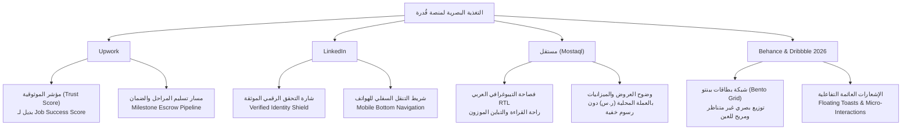

# دراسة التغذية البصرية ومعمارية التجاوب الشامل — منصة قُدرة (QUDRA)
## Visual Identity, Marketplace Benchmarks & Cross-Screen Responsiveness

تم إعداد هذه الدراسة التحليلية والتصميمية بناءً على مراجعة معيارية لمنصات العمل الحر العالمية والإقليمية (**Upwork**, **LinkedIn**, **مستقل**) وأحدث اتجاهات تصميم واجهات الـ SaaS على منصات **Behance** و **Dribbble** لعام 2026، وتطبيقها الفعلي في كود ونظام تصميم منصة **قُدرة**.

---

## 1. التغذية البصرية المقارنة (Marketplace Benchmarks)

### أ. استلهام Upwork (الموثوقية والضمان المالي)
- **مؤشر الموثوقية الشامل (Trust Score):** في Upwork يُعد مؤشر *Job Success Score (JSS)* هو المعيار الأهم للتوظيف. في قُدرة طوّرنا هذا المفهوم ليصبح **مؤشر موثوقية تشفيرياً (94%)** يقيس نسبة الأدلة المثبتة برمجياً مقارنة بالادعاءات الذاتية، ليمنح أصحاب العمل ثقة فورية دون قراءة سير ذاتية طويلة.
- **مسار المراحل وتحويل المخرجات لأدلة (M21):** تم اقتباس نموذج تسليم المراحل والضمان المالي المودع (Escrow)， ولكن مع نقلة نوعية خاصة بقُدرة: عند إتمام المرحلة واستلام المقابل، يتحول المخرج البرمجي المعتمد تلقائياً إلى **دليل رقمي مثبت جديد (Proven Evidence)** في جواز قدرات المستقل.

### ب. استلهام LinkedIn (الهوية الاحترافية وشريط الجوال)
- **شارة التحقق الرسمية المعتمدة (Verified Identity):** مثل نظام التحقق الصارم في LinkedIn عبر بطاقات الهوية الرسمية، وضعنا شارة خضراء دائرية بجوار اسم وصورة المستخدم في الشريط العلوي لتأكيد أن الحساب خضع لتوثيق الهوية والموصلات.
- **شريط التنقل السفلي للهواتف (Mobile Bottom Navigation):** تطبيق نمط LinkedIn الرائد في التنقل السلس عبر الإبهام بيد واحدة عبر 4 أقسام رئيسية وزر استعراض القائمة الكاملة.

### ج. استلهام منصة مستقل (Mostaql) (العربية أولاً وسلاسة التعامل المحلي)
- **أصالة الواجهات العربية (RTL First):** منصة مستقل رائدة في الخطوط العربية المريحة والتفاعل المحلي. استلهمنا منها ضبط خطوط `IBM Plex Sans Arabic` و `Cairo` بارتفاعات أسطر مريحة (`1.75`) دون إقحام مصطلحات أجنبية مربكة بين قوسين.
- **وضوح الميزانيات:** إبراز الميزانيات بالريال السعودي (`ر.س`) مع التأكيد الصريح على الرسوم الصافية والشفافة ومنع الاقتطاعات الخفية.

### د. استلهام Behance و Dribbble (Bento Grid & Visual Ergonomics 2026)
- **تخطيط بينتو (Bento Grid):** التخلي عن التخطيطات التقليدية الرتيبة واعتماد بطاقات متناسقة الحجوم تقود العين بذكاء:
  - بطاقة ترحيب عريضة ملهمة تحوي الإجراء الرئيسي (مشاركة جواز القدرات).
  - 4 بطاقات مؤشرات سريعة بألوان هادئة مطفأة غير مجهدة للعين.
  - بطاقتان رئيسيتان متجاورتان: "الخطوة القادمة لسد الفجوة" و"أقوى مطابقة حالية للمشكلات".
  - سجل الأدلة النشطة الموثقة كقائمة جدولية أنيقة.

---

## 2. استراتيجية التجاوب الشامل على جميع الشاشات (Responsive Design Matrix)

تم اختبار وضبط المنصة لتعمل بمرونة وانسيابية على مختلف قياسات الأجهزة:

| نوع الجهاز | العرض (Viewport) | نمط القائمة الجانبية | توزيع البطاقات (Bento) | شريط التنقل السفلي |
|---|---|---|---|---|
| **الهواتف الذكية (Mobile)** | `< 768px` | درج منزلق (Drawer) بزر إغلاق `X` وخلفية مظللة | عمود واحد مكدس (`1fr`) بعرض 100% | **مفعل ونشط** (5 أيقونات رئيسية بلمس مريح) |
| **الأجهزة اللوحية (Tablet)** | `768px - 1024px` | درج مخفي أو شريط جانبي مدمج | شبكة ثنائية الأعمدة (`2 columns`) | يتكيف حسب عرض الشاشة |
| **شاشات اللابتوب (Laptop)** | `1024px - 1440px` | قائمة جانبية ثابتة دائمة (`264px`) | شبكة ثلاثية ورباعية (`grid-4` & `grid-2`) | مخفي (الاعتماد على الشريط الجانبي) |
| **الشاشات الكبيرة (Desktop/4K)**| `> 1440px` | قائمة جانبية ثابتة مع حاوية مركزية (`1400px`) | شبكة Bento متسعة بهوامش تنفس رحبة | مخفي |

---

## 3. لمسات الراحة البصرية وتجنب إجهاد العين (Visual Ergonomics)

1. **التباين المدروس (Contrast Ratios):** استخدام كود اللون `#0f172a` للنصوص الأساسية و `#475569` للنصوص الفرعية فوق خلفية قماشية ناعمة `#f8fafc`، مما يحقق نسبة تباين تفوق معايير WCAG AAA دون وهج أبيض حاد.
2. **أزرار ملموسة وناعمة:** أزرار بارتفاع 38px بحواف منحنية ناعمة (`10px`)، ذات ظلال خافتة جداً تمنع التشتت البصري.
3. **تدرجات خافتة هادئة:** استخدام تدرج الزمرد المهدئ للأعصاب (`#0d9488` إلى `#0f766e`) الذي يعبر عن الموثوقية والنزاهة التقنية.
4. **نظام الإشعارات المدمج (Toast Notifications):** استبدال النوافذ المنبثقة الصادمة بنوافذ عائمة ذات انزلاق سلس تختفي تلقائياً بعد 3.8 ثوانٍ.
